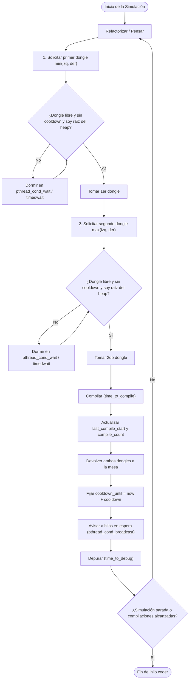
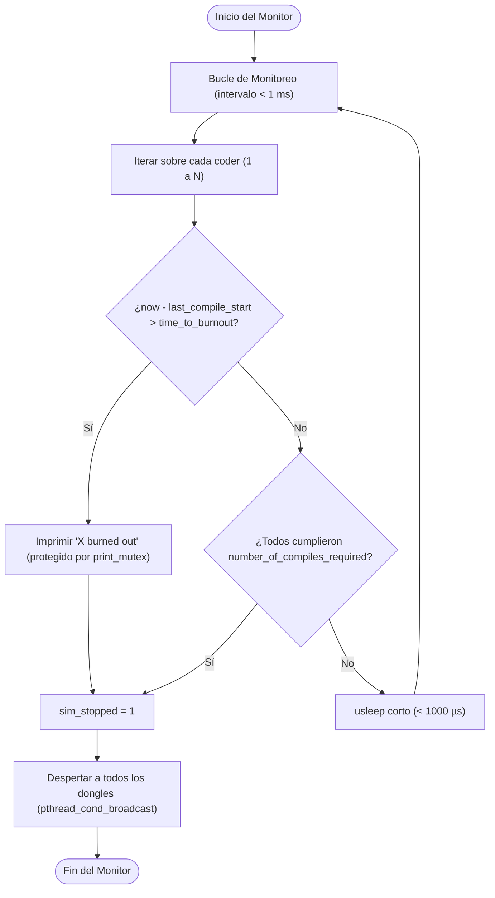
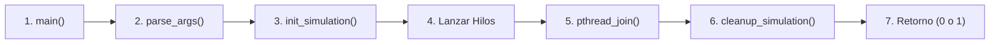

# Arquitectura Técnica, Estructuras y Teoría de Concurrencia - Codexion

> **Proyecto:** `codexion` (Currículo 42)  
> **Tema:** Concurrencia POSIX (`pthread`), exclusión mutua (`mutex`), variables de condición (`condvar`), colas de prioridad (min-heap) y prevención de interbloqueos (*deadlock*).

---

## 1. Visión General y Problema de Fondo

Codexion es una versión avanzada del clásico problema de computación concurrente **"La Cena de los Filósofos"** (*Dining Philosophers* de Edsger Dijkstra), adaptado a programadores que compiten por recursos de hardware escasos:

* **Mesa circular:** Hay $N$ programadores sentados en círculo y exactamente $N$ dongles USB compartidos.
* **Recursos dobles obligatorios:** Para compilar código cuántico, cada programador necesita sostener **dos dongles a la vez** (el de su izquierda y el de su derecha).
* **Restricciones críticas:**
  1. **Sin variables globales:** Todo el estado debe encapsularse en una estructura compartida (`t_data`).
  2. **Detección de agotamiento (*burnout*):** Debe detectarse e imprimirse en terminal con un retraso máximo de **10 ms** respecto al instante real.
  3. **Enfriamiento obligatorio (*cooldown*):** Al soltar un dongle, este queda inutilizable durante `dongle_cooldown` milisegundos.
  4. **Arbitraje justo con Min-Heap:** Si dos personas compiten por el mismo dongle, se atiende estrictamente según la política seleccionada:
     * **FIFO (First In, First Out):** Orden de llegada.
     * **EDF (Earliest Deadline First):** Se prioriza a quien esté más cerca de quemarse (`last_compile_start + time_to_burnout`).

---

## 2. Teoría de Procesos e Hilos: Ciclos de Vida y Estados

En Codexion, **cada programador es un hilo independiente (`pthread_t`)** y el **monitor de agotamiento es otro hilo independiente**.

### A. Ciclo de Vida del Programador (Máquina de Estados)



---

### B. Hilo Monitor de Agotamiento (*Burnout Watchdog*)

El monitor vigila externamente a todos los programadores. Debe ser muy ligero y comprobar periódicamente las marcas de tiempo para cumplir el requisito de los **10 ms de tolerancia**:



---

## 3. Flujo Global del Programa (Pasos de Ejecución)



1. **`parse_args`**: Valida exactamente 8 argumentos obligatorios, descarta números negativos o letras y comprueba si el planificador es `"fifo"` o `"edf"`.
2. **`init_simulation`**: Reserva memoria dinámica para `coders` y `dongles`, inicializa mutexes, variables de condición y las colas min-heap.
3. **Lanzar hilos**:
   * Crea $N$ hilos de programadores (`coder_routine`).
   * Crea 1 hilo monitor (`monitor_routine`).
4. **`pthread_join`**: El hilo principal espera a que el monitor y los programadores completen su ejecución tras recibir la señal de parada (`sim_stopped`).
5. **`cleanup_simulation`**: Destruye todos los mutexes y condvars con `pthread_mutex_destroy` y `pthread_cond_destroy`, y libera toda la memoria dinámica (`free`) sin provocar fugas (*zero memory leaks*).

---

## 4. Estructuras de Datos (`codexion.h`) y su Propósito

### A. Configuración y Planificador
* **`t_sched`:** Enum (`SCHED_FIFO`, `SCHED_EDF`) que evita comparaciones lentas de strings durante la simulación.
* **`t_config`:** Almacena los parámetros leídos de la terminal. Usa `long long` para evitar desbordamientos numéricos en los milisegundos.

### B. Cola de Prioridad Min-Heap (`t_heap_node` y `t_heap`)
```c
typedef struct s_heap_node
{
    int         coder_id;     /* Quién solicita el recurso */
    long long   request_seq;  /* Turno de llegada incremental (FIFO y desempate) */
    long long   deadline;     /* Fecha límite de agotamiento (EDF) */
}   t_heap_node;
```
* Cada dongle tiene su propio heap binario (`t_heap`).
* **Hijo izquierdo:** `2 * i + 1` | **Hijo derecho:** `2 * i + 2` | **Padre:** `(i - 1) / 2`.
* La raíz (`heap->nodes[0]`) siempre contiene al programador con **mayor prioridad** (el menor `request_seq` en FIFO o el menor `deadline` en EDF).

### C. Recurso Dongle (`t_dongle`)
* **`mutex`:** Garantiza exclusión mutua para leer/modificar el estado del dongle.
* **`cond` (`pthread_cond_t`):** Permite suspender al hilo sin consumir ciclos de CPU hasta que el dongle sea liberado.
* **`is_in_use`:** `1` si está ocupado, `0` si está libre.
* **`cooldown_until`:** Timestamp absoluto donde termina el periodo de enfriamiento.
* **`wait_heap`:** Min-heap donde se registran las peticiones en espera de este dongle.

### D. Programador (`t_coder`)
* **`thread`:** Descriptor del hilo POSIX.
* **`last_compile_start`:** Marca temporal de la última compilación iniciada. Base para calcular el *burnout*.
* **`first_dongle_id` y `second_dongle_id`:** Índices ordenados de los dongles contiguos.
* **`data`:** Puntero hacia el contexto global de la simulación.

### E. Contexto Global (`t_data`)
* Agrupa los arrays de `dongles`, `coders`, los mutexes globales (`state_mutex`, `print_mutex`) y la bandera atómica de parada `sim_stopped`.

---

## 5. Prevención de Problemas Clásicos de Concurrencia

### 1. Prevención de Interbloqueos (*Deadlocks*)
Un interbloqueo ocurre si todos los programadores toman a la vez su dongle izquierdo y quedan esperando eternamente el derecho (espera circular).  
**Solución matemática aplicada:**
Romper la condición de espera circular mediante **orden jerárquico estricto**:
$$\text{first\_dongle} = \min(\text{left}, \text{right})$$
$$\text{second\_dongle} = \max(\text{left}, \text{right})$$
Al adquirir siempre los dongles en orden numérico ascendente, el grafo de dependencias de recursos es estrictamente acíclico, haciendo el *deadlock* imposible.

### 2. Prevención de Condiciones de Carrera (*Race Conditions*)
* **Logs serializados:** Todas las llamadas a salida estándar pasan por `print_mutex` para que no se mezclen letras ni líneas.
* **Estado global:** Las lecturas y escrituras de `sim_stopped` y marcas de tiempo se protegen con `state_mutex`.

### 3. Espera Eficiente vs Espera Activa (*Busy Waiting*)
* El uso de `pthread_cond_wait` y `pthread_cond_timedwait` suspende al hilo a nivel de kernel, dejando la CPU libre para el resto de los hilos y para el monitor de agotamiento.
